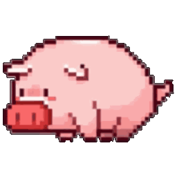

# dsh-whale-pig-widget 🐷

DSH（DeepSeek Harness）网页右下角的**余额小鲸鱼挂件** —— fork 自 [MeteorNOX / dsh-whale-widget](https://github.com/MeteorNOX/DeepSeek-Balance-Whale-Widget) `0.4.2`，**完整保留上游全部功能**，并内置一只会**吃饭**、会**睡觉**的小猪。

> 上游只能「换一张角色图」；这一版把「角色三态」做成正式能力，并把小猪素材和三态判定一起打包：装完就有猪，不用手动导图、改 JS。
> 上游的完整功能说明（余额、泡泡点击序列、逐行样式、音效……）见 [`README.upstream.md`](README.upstream.md)。



## 与上游的差别（只有这三条）

| # | 内容 | 上游 0.4.2 | 本版 0.5.0 |
|---|---|---|---|
| 1 | **角色三态**：待机 → 干活（吃饲料） → 打盹（趴着睡） | 无（一张静态角色图） | 有。宿主新增 `GET /dsh-whale/running.json`，前端每秒对齐；优先级 **干活 > 打盹 > 待机** |
| 2 | **内置小猪** | 需用户自行导入图片 | 首次启动把随包的三态小猪播种进角色目录，角色面板直接多一条「小猪」+ 音效组「猪叫」 |
| 3 | **三个独立开关** | — | `干活形象` / `打盹形象` / `摸一下叫醒`，都存 `localStorage`，互不影响 |
| 4 | **跑完说句话** | — | 一轮跑完叫一声 + 冒一句可编辑的台词（见下节） |

除此之外与上游 0.4.2 **逐行一致**：余额 / 今日已用 / 峰谷定价、自定义泡泡点击序列（文本·余额·今日·峰谷·图片·随机语句与并列加权）、逐行样式与字体、悬浮快捷编辑、拖拽排版、音效与每轮消耗、自定义角色与音效、吸附与翻转。

## 三态怎么判定

```
每 1s: GET /dsh-whale/running.json?role=<当前角色 id>
  ├─ running=true 且存在 <id>-busy.gif  → 播「干活」图（吃饲料）
  ├─ 空闲 ≥ 60s 且存在 <id>-sleep.gif   → 播「打盹」图（趴着睡）
  └─ 其余                                → 播角色本体图
```

- `running` 由宿主监听 `session/event` 的 `turn/start` / `turn/end` 得出；20 分钟无任何事件视为宿主丢了 `turn/end`，自动复位。
- 变体图**不写进 `roles.json`**：只要 `<id>-busy.gif` / `<id>-sleep.gif` 与角色图同目录即可，换角色、重导入、改 id 自动生效；没有变体就一次图都不请求（不闪 404）。
- 两个开关都关掉时前端**完全停止轮询**（零开销）。
- 「摸一下叫醒」默认开：点/拖一下立刻回本体并压住睡意 3 分钟；关掉就能一直趴着睡。

## 内置小猪从哪来

首次启动时 `lib/index.js → ensureBuiltinPig()`：

1. 复制 `assets/builtin/pig.gif`、`pig-busy.gif`、`pig-sleep.gif` 到 `$DSH_HOME/whale-roles/`；
2. 往 `roles.json` 追加 `{ id: "pig", name: "小猪", format: "gif" }`；
3. 复制 `assets/builtin/pig-oink.wav` 到音效目录，追加片段「猪叫」+ 音效组「猪叫」（按下即响）。

播种**只做一次**，成功写标记 `.builtin-pig.v1`。之后你删掉这只猪、改名、置顶、换图，插件都不会再塞回来 —— 它和你自己导入的角色完全平等。

换自己的宠物：覆盖 `assets/builtin/` 下三个同名 GIF 即可，代码不动。尺寸建议正方形 ≤256×256，**背景必须透明**（GIF 1-bit alpha；不透明底会在挂件上糊出一个方块）。

## 说句话（跑完喊一声）

一轮任务跑完（宿主 `last-turn.json` 的 `seq` 递增）→ 小猪**叫一声**（内置 `pig-oink.wav`）并**冒一句台词**，气泡停在角色上方 5.2 秒后淡出。

- **不做定时喊**：只在「跑完」这一刻吭声，没有间隔循环。
- 开关：菜单里「说句话」（`localStorage.dshw-speech`，默认开）。关掉后既不出声也不冒泡。
- 台词：点这一行右边的 ✎ 编辑，**每行一句**，留空保存即恢复默认 8 句（存 `dshw-speech-lines`）。
- 已播轮次记在 `dshw-speech-seq`：刷新页面不会为同一轮重复喊。
- 实现上是独立元素（`.dshwv-speech`）＋ 独立 1.5s 轮询，不碰原有泡泡队列；节点不在就整段跳过，非主界面零请求。

## 安装

```bash
# 1) 先卸掉上游：两者注册同一批 /dsh-whale/* 路由，不能共存
dsh plugin --profile web remove dsh-whale-widget

# 2) 装本版
dsh plugin --profile web add link:/absolute/path/to/dsh-whale-pig-widget
```

也可以交给 DSH 自己装：`plugin_manager` → `action: install_bundle` → `target: /absolute/path/to/dsh-whale-pig-widget`，返回 `application: applied` 即生效（刷新页面一次）。

**数据兼容**：`$DSH_HOME/whale-roles`、`whale-audio`、`.dshw-*.json` 与 `localStorage` 键（`dshw-role`、`dshw-work-look`、`dshw-sleep-look`、`dshw-pet-wake`…）全部沿用上游，替换不丢现有角色、音效与面板配置。

## 目录

```
dsh-whale-pig-widget/
├── lib/index.js             # 宿主：余额/用量/角色/音效路由 + running.json + 内置小猪播种
├── lib/accounting.mjs       # 上游用量账本
├── assets/whale-widget.js   # 前端：整个挂件（含三态切换与三条开关）
├── assets/builtin/          # fork 新增：pig.gif / pig-busy.gif / pig-sleep.gif / pig-oink.wav
├── assets/*                 # 上游素材：鲸鱼本体、泡泡图、内置音效
├── cordis.patch.yml         # bundle patch
├── icon.png                 # 插件图标（沿用上游）
├── PROVENANCE.md            # 素材来源与许可范围（含 fork 增补）
├── README.upstream.md       # 上游 README 原文（功能全量说明）
└── README.md
```

## 许可

- **代码**：MIT。上游 © 2026 MeteorNOX；fork 修改 © 2026 KIM。
- **美术素材**：`assets/` 不在 MIT 覆盖范围内，按 as-is 随插件分发，详见 [`PROVENANCE.md`](PROVENANCE.md)。`assets/builtin/` 的小猪三态与叫声由 fork 作者提供。

## 已知边界

- 与上游**不可同时启用**（同一批路由会重复注册而报错）。
- 「干活」状态来自 turn 事件：插件加载前就在跑的那一轮看不到，下一轮开始即正常。
- 三态是 GIF，体积随帧数走；内置小猪为 256×256 / 255 色 / **1-bit 透明背景**（原图 512×512 二进制 alpha，缩放时按预乘 alpha 采样，不产生黑边），三张共约 1.2 MB。
- 上游的 `pig-rest`（135×84 四态趴睡素材）逻辑保留但互不干扰：它只认 135×84 的图，内置小猪是 256×256，由 `running.json` 这套接管。